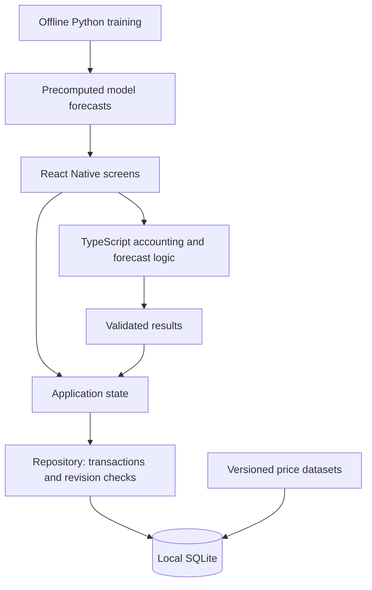

# TrySE — Stock Learning

**Learn a concept. Practice a trade. Explain the result.**

**Live prototype:** https://try-se-stock-learning.vercel.app/

TrySE is a bilingual (Traditional Chinese / English) investing-education app for iOS, Android, and the web. It combines guided lessons, knowledge checks, a paper-trading simulator, and a forecast challenge into a single learning loop, so beginners can move from reading about a concept to applying it with a practice portfolio and understanding why their results changed.

> **Stage:** functional prototype (v0.1). The core product loop, accounting engine, and local persistence are implemented and tested. The prototype runs on synthetic price data; licensed market data, native device certification, and cloud services are the next milestones on the [path to production](#path-to-production).

## Why TrySE

Most beginner investing resources fall into two camps: static articles that never let learners practice, or brokerage-style simulators that assume prior knowledge and reward guessing. TrySE closes that gap:

- **Learning and practice are connected.** Each lesson leads into a hands-on exercise, and the simulator explains cash, cost basis, and realized versus unrealized gains instead of showing only a balance.
- **Built for Taiwan and US markets.** Separate TWD and USD practice wallets, local display conventions (red-for-gain in Chinese, green-for-gain in English), and content in both languages.
- **Forecast literacy, not stock tips.** Learners lock in a prediction, reveal the outcome, and compare themselves with a no-change baseline and a simple model—learning how hard forecasting is rather than being told what to buy.
- **No account required.** Progress is stored on the device, which lowers the barrier for students, classrooms, and first-time investors.

**Target audiences:** beginner retail investors, university and high-school financial-literacy courses, and educational partners (schools, community programs, financial institutions) seeking a safe, no-money-at-risk practice environment.

## Product capabilities

| Capability      | What learners get                                                                                                                      |
| --------------- | -------------------------------------------------------------------------------------------------------------------------------------- |
| Guided learning | Nine bilingual lessons with examples, hints, knowledge checks, and saved answer history.                                               |
| Paper trading   | Buy and sell whole shares, advance a market replay, and inspect cash, holdings, cost basis, and realized/unrealized gains.             |
| Two markets     | Ten Taiwan stocks and ten US stocks, with independent TWD and USD practice wallets.                                                    |
| Forecast lab    | Lock a one- or five-session prediction, reveal the hidden outcome, and compare errors against a baseline and a ridge-regression model. |
| Further reading | Curated external resources with search, language filters, bookmarks, and read status.                                                  |
| Offline-first   | Portfolios, lessons, quiz attempts, and predictions persist across sessions with no sign-up.                                           |

Switching language preserves progress and never changes the selected market or currency.

### Core user journey

1. **Learn** — open a lesson, answer a knowledge check, and review the explanation. Every attempt is retained for review.
2. **Practice** — buy shares, advance the replay, and sell part of a position. The portfolio view breaks down how cash, remaining cost basis, and realized profit changed.
3. **Return** — reopen the app on the same device and continue where you left off, in either language.
4. **Experiment** — lock a forecast, reveal the outcome, and see how it compares with the baseline and the model.

## Built for production from the start

Although TrySE is a prototype, its foundations were designed to scale to a production service rather than be rewritten later.

### Reliable, auditable accounting

The [accounting engine](src/domain/engine.ts) is a pure TypeScript module, fully separated from the UI. It validates every order and returns new portfolio state; displayed text is never used as an accounting source.

- Money is stored as integer minor units (hundredths), eliminating floating-point drift.
- Partial sales release weighted-average cost with an explicit rounding rule; a final sale releases all remaining cost.
- Tests cover purchases, partial and full sales, invalid orders, duplicate submissions, market isolation, and reconciliation.

Because the engine has no UI or storage dependencies, the same logic can run on-device today and on a server later.

### Transactional persistence

The [SQLite repository](src/storage/repository.ts) commits application state and the trade journal in a single transaction; a failed save rolls back both. Revision checks reject stale writes, and portfolios are verified against their journal on every load and save.

- Recorded trades and quiz attempts are append-only.
- Locked forecasts can be revealed but never edited.
- Restarting a replay creates a new session and preserves the previous journal.

These guarantees—atomic writes, optimistic concurrency, and an immutable journal—map directly onto a future server-side database and cross-device sync.

### Leakage-free forecasting

The [forecast pipeline](scripts/train_forecasts.py) trains a scikit-learn ridge-regression model on trailing returns. Each forecast uses only data available at its cutoff, and a dedicated test changes future prices to confirm earlier predictions do not move. The prototype bundles 520 precomputed forecasts for reproducibility; the same pipeline is designed to run as a scheduled job against licensed data.

### Data pipeline with provenance

A [CSV importer](scripts/import_prices.py) validates external price data and stages it with source metadata and a dataset version, establishing the contract for licensed data feeds. Staged datasets are not yet wired into app replays.

### Content governance

Educational content is tied to stable IDs so progress survives translation and revision. Legacy material is preserved in a [review archive](data/legacy/questions.zh-TW.json) with source references and a checksum; only reviewed content is published in the app.

## Architecture



| Layer        | Technology and purpose                                                      |
| ------------ | --------------------------------------------------------------------------- |
| Client       | React Native + Expo + TypeScript; one codebase for iOS, Android, and web.   |
| Storage      | `expo-sqlite`; local prices, application state, and trade journal.          |
| Domain       | Pure TypeScript for orders, accounting, valuation, and forecast evaluation. |
| Testing      | Jest, `jest-expo`, and React Native Testing Library.                        |
| Data tooling | Python CSV validation and versioned SQLite staging imports.                 |
| ML           | Python + scikit-learn; offline training with precomputed predictions.       |
| Hosting      | Vercel static web build (no backend required for the prototype).            |

See the [development notes](docs/DEVELOPMENT.md) for the source map, persistence details, and CSV import contract.

## Prototype boundaries

To keep expectations clear, the current prototype has these limits:

- **Synthetic prices.** The app ships 15,660 generated daily OHLCV records (labeled 2023–2025) for 20 real company identifiers—including TSMC, MediaTek, Hon Hai, Apple, Microsoft, and NVIDIA. Identifiers are real; prices and trading calendars are not. No price API or web crawling is used. See the [instrument catalog](src/data/instruments.json).
- **Simplified trading rules.** Starting cash of TWD 1,000,000 and USD 100,000 in separate wallets; whole shares only; immediate execution at the displayed close; no fees, taxes, leverage, short selling, or currency conversion.
- **Replay scenarios.** Trading exercises use 20 or 60 sessions starting at `2024-01-02`; forecast challenges use separate 2025 cutoffs.
- **Corporate actions.** Split and cash-dividend primitives are implemented and tested, but bundled scenarios contain none, and real entitlement timing is not yet modeled.
- **Device-local only.** No accounts, sync, or analytics.
- **Educational use only.** TrySE is a simulator and does not provide investment advice or connect to real brokerage accounts.

## Path to production

| Milestone                | Scope                                                                                                                                                                                                                                                 |
| ------------------------ | ----------------------------------------------------------------------------------------------------------------------------------------------------------------------------------------------------------------------------------------------------- |
| 1. Production readiness  | Integrate licensed daily history for the initial 20 stocks with real exchange calendars and corporate actions; certify on physical iOS/Android devices; expand and review educational content; app-store release.                                     |
| 2. Platform & scale      | PostgreSQL/Supabase backend for the market catalog, content, and forecasts; scheduled, validated market-data imports; versioned scenario downloads; expansion to Taiwan 50 (0050), S&P 500, and QQQ holdings (~650 instruments, ~1.8M daily records). |
| 3. Accounts & engagement | Optional accounts with cross-device sync and explicit conflict handling; progress analytics; classroom/instructor tools for educational partners.                                                                                                     |
| 4. Realism & insight     | Fees, taxes, settlement, limit orders and order states, multi-currency FX, benchmarks and portfolio analytics, additional models with uncertainty estimates.                                                                                          |
| 5. Grounded AI tutoring  | Bilingual AI tutor grounded in reviewed educational sources, with model and dataset version tracking.                                                                                                                                                 |

The [detailed roadmap](docs/ROADMAP.md) covers the proposed market universe, data-source candidates, database design, and completion criteria. Real-money brokerage integration, if pursued, would be a separate milestone with its own security, compliance, and operational requirements.

## Getting started

Requires **Node.js 22.13+** and npm.

```sh
npm ci
npm run web          # Browser preview
```

Native development:

```sh
npm start            # Expo development server
npm run ios          # Requires Xcode and an iOS simulator
npm run android      # Requires Android SDK and an emulator/device
```

Use an Expo Go version compatible with SDK 57, or a matching development build. The web preview also uses SQLite; `metro.config.js` provides the required cross-origin isolation headers.

### Deploying the web build

Import the repository into Vercel with **Framework Preset: Other** and the repository root. [vercel.json](vercel.json) defines the export command, `dist` output directory, and SQLite isolation headers; no environment variables or backend services are required. See the [deployment guide](docs/DEPLOYMENT.md) for details and troubleshooting. Native app distribution is handled separately.

## Quality and verification

```sh
npm run check          # TypeScript, Jest, SQLite persistence, CSV importer tests
npm run format:check
npm run export:native  # iOS/Android JS and Hermes bundles (unsigned)
```

Forecast model tests:

```sh
python3 -m venv .venv
.venv/bin/python -m pip install -r scripts/requirements.txt
npm run test:models
```

Automated tests cover accounting, transaction rollback, history immutability, lesson interactions, CSV validation, and future-data isolation. Browser flows—trading, persistence across reloads, bilingual themes, bookmarks, and forecast reveal—have been verified manually. iOS and Android bundles export successfully; on-device verification is part of Milestone 1.

## Background

TrySE began as a 2019 Android capstone project with nine lessons, a 50-question quiz bank, and a two-stock simulator. This version is a ground-up rebuild: a cross-platform codebase, a tested accounting engine replacing the original trading logic, a forecast challenge, and a data and architecture foundation intended to grow into a production learning platform. The original repository is preserved unchanged.
